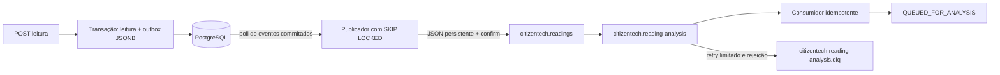

# CitizenTech API

Backend provisório da solução CitizenTech voltada ao apoio inteligente de pequenos produtores.
O nome definitivo do produto ainda será escolhido.

## Tecnologias iniciais

- Java 21
- Spring Boot 4.1.2
- Spring Data JPA
- Spring Security e OAuth2 Resource Server
- PostgreSQL com PGvector
- Flyway
- RabbitMQ
- Spring AI 2.0.2 com Gemini Developer API e RAG/PGVector
- Docker Compose

## Execução local

1. Copie `.env.example` para `.env` e ajuste os valores locais.
2. Suba PostgreSQL/PGvector e RabbitMQ:

```bash
docker compose up -d
```

3. Exporte as variáveis de `.env` no terminal ou configure-as no ambiente de execução da IDE.
   O Docker Compose lê `.env`, mas isso não exporta as variáveis para o processo Java.
   Defina `JWT_SECRET` com um segredo aleatório de pelo menos 32 caracteres, mantido fora do repositório.
   `GOOGLE_API_KEY` só é necessária com `APP_AI_ENABLED=true`. Por padrão, a IA fica desativada.
4. Inicie a API:

```bash
./mvnw spring-boot:run
```

No PowerShell, use `./mvnw.cmd spring-boot:run` e configure as variáveis com
`$env:NOME_DA_VARIAVEL = 'valor'`.

## Serviços locais

- API: `http://localhost:8080`
- Health check: `http://localhost:8080/actuator/health`
- PostgreSQL: `localhost:5432`
- RabbitMQ: `localhost:5672`
- RabbitMQ Management: `http://localhost:15672`

## Domínio inicial

- Usuário: produtor, técnico ou administrador.
- Propriedade: sempre vinculada ao proprietário autenticado.
- Área de cultivo: sempre vinculada a uma propriedade do usuário.

Sensores registram medições agrícolas. A análise agronômica assíncrona utiliza Gemini,
Spring AI e RAG institucional, quando explicitamente habilitada.

## Autenticação JWT

### Variáveis de ambiente

| Variável | Descrição |
| --- | --- |
| `JWT_ISSUER` | Emissor esperado pelo validador. Padrão: `citizentech-api`. |
| `JWT_SECRET` | Segredo HMAC de pelo menos 32 caracteres. Use um valor aleatório externo ao repositório. O fallback de desenvolvimento e o texto de `.env.example` devem ser substituídos. |
| `JWT_EXPIRATION_MINUTES` | Validade positiva do token em minutos. Padrão: `120`. |

A aplicação valida essas propriedades ao iniciar. Alterar o segredo invalida os tokens já emitidos.

### Cadastro

`POST /api/auth/register` retorna **201** com o usuário e um token.

```json
{
  "name": "Produtor Teste",
  "email": "produtor@teste.com",
  "password": "12345678"
}
```

O nome é obrigatório e aceita até 100 caracteres; o e-mail é obrigatório, válido e aceita
até 150 caracteres após normalização com trim e lowercase. A senha deve ter de 8 a 72
caracteres e é armazenada como hash PBKDF2 com salt pelo `PasswordEncoder` do Spring.
As senhas dos exemplos servem apenas para teste local.

Todo cadastro público cria um usuário **PRODUCER**. O corpo não aceita `role` nem outros
campos desconhecidos: enviá-los retorna **400**, inclusive com `PRODUCER`.
Não é possível se cadastrar como `TECHNICIAN` ou `ADMIN`. E-mail duplicado retorna **409**,
inclusive quando muda apenas a capitalização; um índice único também protege cadastros concorrentes.

```bash
curl -i -X POST http://localhost:8080/api/auth/register \
  -H 'Content-Type: application/json' \
  -d '{"name":"Produtor Teste","email":"produtor@teste.com","password":"12345678"}'
```

### Login

`POST /api/auth/login` retorna **200**. E-mail é normalizado também no login.
Credenciais incorretas ou usuário desativado retornam **401**.

```json
{
  "email": "produtor@teste.com",
  "password": "12345678"
}
```

```bash
curl -i -X POST http://localhost:8080/api/auth/login \
  -H 'Content-Type: application/json' \
  -d '{"email":"produtor@teste.com","password":"12345678"}'
```

Cadastro e login retornam o mesmo formato (valores ilustrativos):

```json
{
  "token": "<JWT retornado pela API>",
  "tokenType": "Bearer",
  "expiresAt": "2026-11-08T22:00:00Z",
  "user": {
    "id": 1,
    "name": "Produtor Teste",
    "email": "produtor@teste.com",
    "role": "PRODUCER"
  }
}
```

### Usar o token

Copie o campo `token` do cadastro ou login e envie-o no cabeçalho `Authorization`:

```bash
curl -i http://localhost:8080/api/auth/me \
  -H 'Authorization: Bearer <TOKEN>'
```

`GET /api/auth/me` busca o usuário pelo e-mail do `sub` do JWT e retorna apenas
`id`, `name`, `email` e `role`. Usuário removido retorna **404**. Sem token, com assinatura
inválida, emissor incorreto ou token expirado, a API retorna **401**. O validador usa a
tolerância de relógio padrão do Spring Security (60 segundos).

O login passa por `AuthenticationManager`, `DaoAuthenticationProvider`, `UserDetailsService`
e `PasswordEncoder`. O `NimbusJwtEncoder` emite JWT HS256 com `iss`, `sub`, `iat`, `exp`,
`userId` e `roles` (lista). O OAuth2 Resource Server usa `NimbusJwtDecoder` para validar
a assinatura, o emissor e a validade. `roles` é convertido para authorities `ROLE_...`.
A API não cria sessão; não há formulário de login, HTTP Basic ou filtro JWT manual.

Somente `POST /api/auth/register`, `POST /api/auth/login` e `GET /actuator/health`
são públicos. Todas as demais rotas exigem JWT.

Os exemplos curl acima usam a sintaxe Bash. No PowerShell, use `curl.exe` com os
argumentos em uma linha e um arquivo JSON (`--data-binary '@register.json'` ou
`--data-binary '@login.json'`) para evitar diferenças de escape entre versões.

### Respostas de erro

Validação e JSON inválido: **400**; credenciais/token inválidos: **401**; acesso negado:
**403**; usuário não encontrado: **404**; e-mail duplicado: **409**; erro inesperado: **500**.
Respostas não incluem stack trace, SQL ou senha.

```json
{
  "timestamp": "2026-11-08T20:00:00Z",
  "status": 400,
  "error": "Bad Request",
  "message": "Dados inválidos",
  "path": "/api/auth/register",
  "fields": {"email": "E-mail inválido"}
}
```

## Propriedades rurais (Farm)

Todos os endpoints exigem JWT com papel `PRODUCER`. O usuário é buscado no banco pelo
e-mail do `sub`; também deve continuar ativo e com papel `PRODUCER` no banco.
O fluxo de autenticação permanece o mesmo. `TECHNICIAN` e `ADMIN` recebem **403** neste módulo.

| Método | Endpoint | Resultado |
| --- | --- | --- |
| POST | `/api/farms` | **201**, propriedade criada para o produtor autenticado. |
| GET | `/api/farms?page=0&size=20` | **200**, página contendo apenas propriedades do produtor. |
| GET | `/api/farms/{id}` | **200**, propriedade do produtor. |
| PUT | `/api/farms/{id}` | **200**, substitui os campos editáveis da propriedade do produtor. |
| DELETE | `/api/farms/{id}` | **204**, sem corpo. |

Consulta, edição e exclusão retornam o mesmo **404** para IDs inexistentes ou pertencentes
a outro produtor. Não há transferência de propriedade. `userId`, `ownerId`, `owner` e
outros campos desconhecidos no JSON são rejeitados com **400**.

POST e PUT usam o mesmo corpo, com todos os campos obrigatórios:

```json
{
  "name": "Fazenda Sol",
  "city": "Campinas",
  "state": "SP",
  "totalArea": 25.50,
  "areaUnit": "HECTARE"
}
```

- `name`: de 3 a 100 caracteres após trim.
- `city`: obrigatória, até 100 caracteres após trim.
- `state`: uma das 27 siglas brasileiras; aceita minúsculas e normaliza para maiúsculas após trim.
- `totalArea`: positiva, até 10 dígitos inteiros e 2 casas decimais, sem arredondamento silencioso.
- `areaUnit`: `HECTARE` ou `SQUARE_METER`, reutilizando o enum existente.

A resposta individual contém somente `id`, `name`, `city`, `state`, `totalArea` e `areaUnit`.
Não inclui entidades relacionadas, e-mails, IDs do proprietário ou credenciais.
Na criação, os campos internos existentes `responsibleName` e `country` são preenchidos
com o nome do produtor e `Brasil`, respectivamente. O PUT preserva esses campos,
o proprietário e as coordenadas já existentes; edita somente os campos do corpo acima.

A listagem ordena por `id` crescente e retorna:

```json
{
  "content": [
    {"id": 1, "name": "Fazenda Sol", "city": "Campinas", "state": "SP", "totalArea": 25.50, "areaUnit": "HECTARE"}
  ],
  "page": 0,
  "size": 20,
  "totalElements": 1,
  "totalPages": 1
}
```

`page` começa em zero e `size` aceita de 1 a 100. Valores inválidos e IDs não numéricos
retornam **400** no formato `ApiErrorResponse`, assim como erros de Bean Validation.
Sem token, a resposta é **401**.

A migration **V3** adiciona `total_area` e `area_unit`, sem modificar V1 ou V2.
Registros antigos mantêm ambos como `null` até serem atualizados com uma área real;
não há backfill com tamanho fictício. A constraint do banco exige que ambos estejam
ausentes ou que ambos sejam válidos, com área positiva e unidade conhecida.
As FKs `farms → users` e `crop_areas → farms`, e seus índices, foram preservados.
Excluir uma propriedade com áreas de cultivo vinculadas retorna **409** e mantém
os dois registros; não há exclusão em cascata.

### Exemplos PowerShell com curl.exe

Com a API iniciada e um produtor cadastrado, faça login e capture o token:

```powershell
$auth = '{"email":"produtor@teste.com","password":"12345678"}' |
  curl.exe -sS http://localhost:8080/api/auth/login -H "Content-Type: application/json" --data-binary "@-" |
  ConvertFrom-Json
$token = $auth.token

# Criar e capturar o ID
$farm = '{"name":"Fazenda Sol","city":"Campinas","state":"SP","totalArea":25.50,"areaUnit":"HECTARE"}' |
  curl.exe -sS http://localhost:8080/api/farms -H "Authorization: Bearer $token" -H "Content-Type: application/json" --data-binary "@-" |
  ConvertFrom-Json
$farmId = $farm.id

# Listar e consultar
curl.exe -i "http://localhost:8080/api/farms?page=0&size=20" -H "Authorization: Bearer $token"
curl.exe -i "http://localhost:8080/api/farms/$farmId" -H "Authorization: Bearer $token"

# Atualizar todos os campos editáveis
'{"name":"Fazenda Lua","city":"Londrina","state":"PR","totalArea":1000.25,"areaUnit":"SQUARE_METER"}' |
  curl.exe -i -X PUT "http://localhost:8080/api/farms/$farmId" -H "Authorization: Bearer $token" -H "Content-Type: application/json" --data-binary "@-"

# Excluir (sem áreas de cultivo vinculadas)
curl.exe -i -X DELETE "http://localhost:8080/api/farms/$farmId" -H "Authorization: Bearer $token"
```

O JSON é enviado por stdin para evitar diferenças de escape entre versões do PowerShell.

## Áreas de cultivo (CropArea)

Os seis endpoints exigem um `PRODUCER` ativo, identificado exclusivamente pelo e-mail
do `sub` do JWT e conferido no banco, seguindo o mesmo padrão de Farm.

| Método | Endpoint | Sucesso |
| --- | --- | --- |
| POST | `/api/crop-areas` | 201 |
| GET | `/api/crop-areas?page=0&size=20` | 200 |
| GET | `/api/crop-areas/{id}` | 200 |
| PUT | `/api/crop-areas/{id}` | 200 |
| DELETE | `/api/crop-areas/{id}` | 204, sem corpo |
| GET | `/api/farms/{farmId}/crop-areas?page=0&size=20` | 200 |

POST e PUT aceitam o mesmo corpo. `farmId`, `name`, `cropType`, `areaSize` e `areaUnit`
são obrigatórios; os demais campos são opcionais:

```json
{
  "farmId": 1,
  "name": "Talhão A",
  "cropType": "Milho",
  "areaSize": 1.25,
  "areaUnit": "HECTARE",
  "latitude": -22.900000,
  "longitude": -47.060000,
  "description": "Cultivo irrigado"
}
```

Nome aceita de 3 a 120 caracteres e tipo de cultivo de 2 a 80, após trim.
A área deve ser positiva, com até 10 dígitos inteiros e 2 casas decimais.
Unidades válidas: `HECTARE` e `SQUARE_METER`. A descrição aceita até 500 caracteres.
Latitude aceita de -90 a 90, longitude de -180 a 180, ambas com até 6 casas decimais.
As coordenadas devem estar presentes juntas ou ambas ausentes/null; um par incompleto
retorna **400**, com mensagem em `fields.coordinatesComplete`.

O status inicial é sempre `NORMAL`. `status`, `userId`, `ownerId`, `owner` e outros campos
desconhecidos no JSON retornam **400**. O PUT preserva o status atual, inclusive se ele
for futuramente alterado pelo monitoramento. O PUT substitui os campos editáveis; campos
opcionais omitidos são limpos. Pode trocar a Farm apenas por outra do mesmo produtor.

A resposta individual contém exclusivamente `id`, `farmId`, `farmName`, `name`,
`cropType`, `areaSize`, `areaUnit`, `status`, `latitude`, `longitude`, `description`,
`createdAt` e `updatedAt`. Não inclui entidades JPA, proprietário ou credenciais.
As listagens usam `content`, `page`, `size`, `totalElements` e `totalPages`, ordenadas por
ID crescente, com página inicial zero e tamanho de 1 a 100 (padrão 20).
As consultas carregam a Farm junto com a área para evitar N+1 ao obter `farmName`.

Áreas e Farms inexistentes ou de outro produtor retornam **404**. A listagem por uma
Farm alheia também retorna **404**, em vez de revelar sua existência por uma lista vazia.
Validações retornam **400**, ausência de JWT **401**, e papel/estado não permitido **403**,
sempre no formato `ApiErrorResponse` existente.

### Capacidade da propriedade

Se `totalArea` estiver preenchido, a soma das áreas não pode ultrapassá-lo. O cálculo
usa `BigDecimal` em metros quadrados: **1 hectare = 10.000 m²**, sem arredondamento na
conversão. No PUT, a área anterior do próprio registro é excluída da soma do destino.
Excesso retorna **409** com a mensagem:
`A soma das áreas de cultivo ultrapassa a área total da propriedade`.
Farms antigas sem área total não recebem um limite fictício.

As escritas mantêm bloqueios transacionais no PostgreSQL sobre as Farms envolvidas,
adquiridos em ordem de ID nas transferências, para proteger a capacidade contra
requisições concorrentes. Reduzir a área total de uma Farm abaixo do que está ocupado
também retorna **409**, inclusive quando sua unidade muda. Excluir ou transferir uma
CropArea libera capacidade na Farm de origem.

O CRUD de CropArea reutiliza as tabelas, FKs, constraints e índices das migrations
V1–V3, sem alterar seu conteúdo.

### Exemplos PowerShell

Usando `$token` do login e `$farmId` de uma propriedade do produtor:

```powershell
$body = @{ farmId = $farmId; name = 'Talhao A'; cropType = 'Milho'; areaSize = 1.25;
  areaUnit = 'HECTARE'; latitude = -22.9; longitude = -47.06; description = 'Cultivo irrigado' }

# Criar e capturar o ID
$crop = $body | ConvertTo-Json -Compress |
  curl.exe -sS http://localhost:8080/api/crop-areas -H "Authorization: Bearer $token" -H "Content-Type: application/json" --data-binary "@-" |
  ConvertFrom-Json
$cropId = $crop.id

# Listar, consultar e listar por Farm
curl.exe -i "http://localhost:8080/api/crop-areas?page=0&size=20" -H "Authorization: Bearer $token"
curl.exe -i "http://localhost:8080/api/crop-areas/$cropId" -H "Authorization: Bearer $token"
curl.exe -i "http://localhost:8080/api/farms/$farmId/crop-areas?page=0&size=20" -H "Authorization: Bearer $token"

# Atualizar; para transferir, use em farmId o ID de outra Farm própria
$body.name = 'Talhao Atualizado'
$body.areaSize = 1.50
$body | ConvertTo-Json -Compress |
  curl.exe -i -X PUT "http://localhost:8080/api/crop-areas/$cropId" -H "Authorization: Bearer $token" -H "Content-Type: application/json" --data-binary "@-"

# Excluir
curl.exe -i -X DELETE "http://localhost:8080/api/crop-areas/$cropId" -H "Authorization: Bearer $token"
```

## Sensores

Relacionamento: **Farm → CropArea → Sensor**. O modelo usa uma única entidade Sensor
com enum de tipo e um ID estável para vincular futuras leituras.
Todos os endpoints exigem um `PRODUCER` ativo, identificado pelo `sub` do JWT e
conferido no banco. Recursos inexistentes ou alheios retornam **404**, inclusive
a CropArea de destino e a listagem por uma CropArea alheia.

| Método | Endpoint | Sucesso |
| --- | --- | --- |
| POST | `/api/sensors` | 201 |
| GET | `/api/sensors?page=0&size=20` | 200 |
| GET | `/api/sensors/{id}` | 200 |
| PUT | `/api/sensors/{id}` | 200 |
| DELETE | `/api/sensors/{id}` | 204, sem corpo |
| GET | `/api/crop-areas/{cropAreaId}/sensors?page=0&size=20` | 200 |

Cadastro:

```json
{
  "cropAreaId": 1,
  "name": "Sensor de solo",
  "deviceCode": "SOLO-001",
  "sensorType": "SOIL_MOISTURE",
  "description": "Sensor instalado no talhão"
}
```

- `cropAreaId`: obrigatório e deve pertencer ao produtor autenticado.
- `name`: obrigatório, de 3 a 100 caracteres após trim.
- `deviceCode`: obrigatório no POST, de 3 a 80 caracteres, normalizado com trim e
  uppercase. É único em toda a API, ignorando capitalização. Duplicidade retorna **409**,
  também em requisições concorrentes.
- `sensorType`: obrigatório; `SOIL_MOISTURE`, `TEMPERATURE`, `HUMIDITY` ou `WEATHER_STATION`.
- `installationDate`: data ISO `yyyy-MM-dd`, opcional; no cadastro, ausência/null usa a
  data atual da aplicação. Datas futuras são rejeitadas.
- `description`: opcional, até 500 caracteres.

O cadastro sempre define `ACTIVE`; enviar `status` no POST retorna **400**, mesmo com
o valor `ACTIVE`. No PUT, são obrigatórios `cropAreaId`, `name` e `sensorType`.
`deviceCode`, `status` e `installationDate` omitidos/null preservam o valor atual;
código informado deve ser válido e único, e status informado aceita `ACTIVE`,
`INACTIVE` ou `FAULT`. A descrição omitida/null é limpa. A transferência só pode
ser feita para outra CropArea própria. Campos `userId`, `ownerId`, `owner`, `farmId`
e outros desconhecidos no JSON são rejeitados com **400**.

A resposta contém `id`, `cropAreaId`, `cropAreaName`, `farmId`, `farmName`, `name`,
`deviceCode`, `sensorType`, `status`, `installationDate`, `description`, `createdAt`
e `updatedAt`, sem entidades JPA ou credenciais. Listagens seguem o envelope
`content`, `page`, `size`, `totalElements`, `totalPages`, por ID crescente; tamanho
de 1 a 100, padrão 20. CropArea e Farm são carregadas juntas para evitar N+1.

A migration **V4__create_sensors.sql** cria a tabela, a FK `fk_sensors_crop_area`
com `ON DELETE RESTRICT`, o índice `idx_sensors_crop_area_id` e o índice único
`ux_sensors_device_code_upper` sobre `upper(device_code)`. Migrations anteriores
permanecem intactas. Excluir uma CropArea com sensores retorna **409** e mantém
ambos os registros; não há cascade remove. Após remover ou transferir seus sensores,
a CropArea pode ser excluída normalmente. Erros mantêm o formato `ApiErrorResponse`.

Exemplos PowerShell, usando `$token` do login e `$cropAreaId` de uma CropArea própria:

```powershell
$body = @{ cropAreaId = $cropAreaId; name = 'Sensor Solo'; deviceCode = 'solo-001'; sensorType = 'SOIL_MOISTURE' }
$sensor = $body | ConvertTo-Json -Compress |
  curl.exe -sS http://localhost:8080/api/sensors -H "Authorization: Bearer $token" -H "Content-Type: application/json" --data-binary "@-" |
  ConvertFrom-Json
$sensorId = $sensor.id

curl.exe -i "http://localhost:8080/api/sensors?page=0&size=20" -H "Authorization: Bearer $token"
curl.exe -i "http://localhost:8080/api/sensors/$sensorId" -H "Authorization: Bearer $token"
curl.exe -i "http://localhost:8080/api/crop-areas/$cropAreaId/sensors?page=0&size=20" -H "Authorization: Bearer $token"

# Atualizar status preservando o código; para transferir, altere cropAreaId para outra área própria.
$body.Remove('deviceCode')
$body.status = 'INACTIVE'
$body | ConvertTo-Json -Compress |
  curl.exe -i -X PUT "http://localhost:8080/api/sensors/$sensorId" -H "Authorization: Bearer $token" -H "Content-Type: application/json" --data-binary "@-"

curl.exe -i -X DELETE "http://localhost:8080/api/sensors/$sensorId" -H "Authorization: Bearer $token"
```

## Leituras e processamento assíncrono

As leituras pertencem ao Sensor e herdam o isolamento por produtor da cadeia
Farm → CropArea → Sensor. Somente `PRODUCER` ativo, identificado pelo `sub` do JWT,
pode criar, consultar ou excluir suas leituras. Sensor alheio/inexistente retorna **404**;
Sensor `INACTIVE` ou `FAULT` retorna **409** ao registrar uma leitura.

| Método | Endpoint | Sucesso |
| --- | --- | --- |
| POST | `/api/sensor-readings` | 201 |
| GET | `/api/sensor-readings?page=0&size=20` | 200 |
| GET | `/api/sensor-readings/{id}` | 200 |
| DELETE | `/api/sensor-readings/{id}` | 204 |
| GET | `/api/sensors/{sensorId}/readings?page=0&size=20` | 200 |
| GET | `/api/crop-areas/{cropAreaId}/readings?page=0&size=20` | 200 |
| GET | `/api/crop-areas/{cropAreaId}/readings/latest` | 200, ou 404 sem leitura |

Não há PUT: medições são imutáveis. Listagens usam o envelope de paginação existente,
ordenadas por `measuredAt` decrescente, com desempate por ID decrescente. `page` começa
em zero; `size` aceita 1–100, padrão 20. Sensor, CropArea e Farm são carregados juntos.
A resposta contém seus IDs/nomes, tipo do sensor, quatro valores, `measuredAt`, `source`,
`analysisStatus`, `createdAt` e `updatedAt`, sem entidades JPA ou credenciais.

Exemplo de cadastro:

```json
{
  "sensorId": 1,
  "temperatureCelsius": 25.5,
  "airHumidityPercent": 60,
  "soilMoisturePercent": 42.75,
  "batteryPercent": 90,
  "source": "MANUAL"
}
```

`sensorId` é obrigatório. Deve haver ao menos um dos quatro valores numéricos.
Temperatura aceita -50 a 70 °C; umidades e bateria aceitam 0 a 100%, com até 3 casas
decimais. `SOIL_MOISTURE` exige umidade do solo; `TEMPERATURE`, temperatura;
`HUMIDITY`, umidade do ar; `WEATHER_STATION` aceita qualquer combinação não vazia
dos quatro valores. Medições adicionais são permitidas para todos os tipos.
`measuredAt` é opcional (instante atual), aceita ISO-8601 e tolera até 5 minutos no futuro.
`source` omitido é `MANUAL`; `DEVICE` é reservado e rejeitado nesta etapa.
`ownerId`, `userId`, `farmId`, `cropAreaId`, `status` e `analysisStatus` no JSON são rejeitados.
Validações e erros mantêm o formato `ApiErrorResponse`.

### Outbox e RabbitMQ



A migration **V5__sensor_readings_and_outbox.sql** cria `sensor_readings` e
`outbox_events` (payload JSONB), com constraints, FK sem cascade remove e índices
por Sensor/data/status de análise e status/data da outbox. Migrations anteriores
permanecem intactas.

1. A API grava leitura `PENDING_PUBLICATION` e evento `SensorReadingCreated` na mesma
   transação. Falha em qualquer gravação causa rollback de ambas. A API não publica no broker.
2. O scheduler usa uma transação própria e pequenos lotes com `FOR UPDATE SKIP LOCKED`.
   Eventos não commitados não são visíveis, e duas instâncias não publicam a mesma linha
   simultaneamente. O payload contém somente IDs, data e medições, sem dados pessoais.
3. O publicador envia JSON persistente ao exchange durável `citizentech.readings`,
   routing key `sensor.reading.created`. Só marca `PUBLISHED` após ACK do broker e
   confirmação de que não houve retorno por falta de rota (`mandatory`).
4. Falhas incrementam `attempts`, registram erro sanitizado e adiam `nextAttemptAt`;
   após o limite, a outbox fica `FAILED`, com evento e leitura preservados.
5. O listener muda apenas `PENDING_PUBLICATION` para `QUEUED_FOR_ANALYSIS`, com transação
   de banco concluída antes do ACK da mensagem. Repetições em `QUEUED_FOR_ANALYSIS` ou
   `ANALYZED` não geram alteração. Com a IA desativada, a leitura permanece em
   `QUEUED_FOR_ANALYSIS`; quando habilitada, segue para a análise agronômica descrita abaixo.

A entrega é **at least once**: queda após o envio e antes do commit da outbox pode
republicar o evento. A transição idempotente absorve essa duplicação.
Falhas do consumidor têm retry com backoff; ao esgotar, a mensagem é rejeitada para o
exchange `citizentech.readings.dlx`, rota `sensor.reading.failed`, e a DLQ acima.
Leitura inexistente ou evento inconsistente gera erro, permitindo retry/DLQ.

Sensor com leituras não pode ser excluído (**409**). Uma leitura só pode ser excluída
enquanto não estiver `ANALYZED`. Na exclusão, eventos ainda `PENDING` ficam `FAILED`
com o motivo da remoção; não são apagados. Se o evento já foi publicado e a leitura
for removida antes do consumo, a mensagem segue retry/DLQ. Não há exclusão automática
de leituras por remoção de Sensor ou outras entidades. Retenção, reprocessamento
operacional de eventos `FAILED` e consumo da DLQ ficam para uma etapa posterior.

### Ambiente e configuração

O starter AMQP já era uma dependência do projeto. Usa-se Spring AMQP 4.1.2, Jackson 3
(`JacksonJsonMessageConverter`) e retry do Boot 4, sem Java Serialization.
O Compose mantém PostgreSQL/PGvector e a imagem oficial `rabbitmq:4.1-management`,
com volume e hostname estável para preservar dados do broker.

```powershell
# Na primeira execução, copie o exemplo e ajuste os valores locais.
Copy-Item .env.example .env
# Carregue as variáveis no processo que executará o Java (Compose lê .env por conta própria).
Get-Content .env | ForEach-Object {
  if ($_ -match '^([A-Za-z_][A-Za-z0-9_]*)=(.*)$') {
    [Environment]::SetEnvironmentVariable($matches[1], $matches[2], 'Process')
  }
}
docker compose up -d
./mvnw.cmd spring-boot:run
```

Painel: **http://localhost:15672**. AMQP: `localhost:5672`. Use `RABBITMQ_USERNAME`
e `RABBITMQ_PASSWORD` definidos no ambiente; `.env.example` contém apenas valores de
desenvolvimento. Substitua também o placeholder `JWT_SECRET` antes de executar.
Se o broker já tiver dados persistidos, alterar variáveis de credenciais não altera
automaticamente os usuários existentes do RabbitMQ.

| Variável | Padrão / função |
| --- | --- |
| `RABBITMQ_HOST`, `RABBITMQ_PORT` | `localhost`, `5672` |
| `RABBITMQ_MANAGEMENT_PORT` | `15672` no Compose |
| `RABBITMQ_USERNAME`, `RABBITMQ_PASSWORD` | Obrigatórias para execução local; não há credenciais no código Java |
| `READINGS_MESSAGING_ENABLED` | `true`, ativa topologia e listener |
| `READINGS_CONSUMER_MAX_RETRIES` | `2` retries após a entrega inicial, backoff de 1 a 10 segundos |
| `OUTBOX_ENABLED` | `true`, ativa o scheduler |
| `OUTBOX_BATCH_SIZE` | `10`, máximo configurável de 100 |
| `OUTBOX_POLL_INTERVAL_MS` | `5000`, intervalo após cada lote |
| `OUTBOX_RETRY_DELAY_MS` | `30000`, espera mínima entre tentativas por evento |
| `OUTBOX_MAX_ATTEMPTS` | `5`, limite de falhas antes de `FAILED` |
| `OUTBOX_CONFIRM_TIMEOUT_MS` | `5000`, espera por confirmação do broker |

### Exemplos PowerShell

Usando `$token` do login, `$sensorId` de um sensor ACTIVE próprio e `$cropAreaId`:

```powershell
$body = @{ sensorId = $sensorId; temperatureCelsius = 25.5; airHumidityPercent = 60; soilMoisturePercent = 42.75; batteryPercent = 90 }
$reading = $body | ConvertTo-Json -Compress |
  curl.exe -sS http://localhost:8080/api/sensor-readings -H "Authorization: Bearer $token" -H "Content-Type: application/json" --data-binary "@-" |
  ConvertFrom-Json
$readingId = $reading.id

curl.exe -i "http://localhost:8080/api/sensor-readings/$readingId" -H "Authorization: Bearer $token"
curl.exe -i "http://localhost:8080/api/sensor-readings?page=0&size=20" -H "Authorization: Bearer $token"
curl.exe -i "http://localhost:8080/api/sensors/$sensorId/readings?page=0&size=20" -H "Authorization: Bearer $token"
curl.exe -i "http://localhost:8080/api/crop-areas/$cropAreaId/readings?page=0&size=20" -H "Authorization: Bearer $token"
curl.exe -i "http://localhost:8080/api/crop-areas/$cropAreaId/readings/latest" -H "Authorization: Bearer $token"
curl.exe -i -X DELETE "http://localhost:8080/api/sensor-readings/$readingId" -H "Authorization: Bearer $token"
```

## Testes e empacotamento

Com Java 21 e Docker em execução:

```bash
./mvnw test
./mvnw clean package
```

No PowerShell, use `./mvnw.cmd test` e `./mvnw.cmd clean package`.
Os testes usam MockMvc com a cadeia real de segurança, hashes e JWTs reais,
e PostgreSQL/PGvector em um container descartável do Testcontainers.
Não usam H2, mocks de autenticação ou o banco local do Compose. Os cadastros existem
apenas durante os testes, com rollback ou limpeza explícita no teste concorrente,
e o container é removido ao encerrar a suíte.
O teste original de carregamento do contexto foi preservado e usa a mesma infraestrutura isolada.
Os testes de Farm cobrem CRUD com persistência real, paginação, isolamento entre produtores,
rejeição de IDs de proprietário no JSON, validações, ausência de token, papéis não autorizados,
produtor desativado, preservação de dados antigos e bloqueio da exclusão com áreas vinculadas.
Os testes de CropArea cobrem CRUD e campos persistidos, status, validações e coordenadas,
paginação geral/por Farm sem N+1, isolamento e permissões, transferência entre Farms,
conversão das duas unidades, capacidade, redução da Farm e cadastros concorrentes.
Os testes de Sensor cobrem CRUD, valores iniciais, datas, normalização e unicidade
global/concorrente de código, status, transferência, paginação sem N+1, isolamento,
validações, permissões, campos proibidos e exclusão protegida da CropArea.
Testes de leituras/outbox cobrem validação por tipo, isolamento, atomicidade/rollback,
payload privado, eventos não commitados, ordenação/latest, exclusões, idempotência,
retry/backoff e publicadores concorrentes. Os testes normais desativam scheduler e
listener e não exigem RabbitMQ externo; falhas de envio usam mocks. Somente os dois
testes de `ReadingRabbitIntegrationTests` iniciam um RabbitMQ descartável, comprovando
publicação com confirms, consumo e retry/DLQ reais.

Durante o desenvolvimento, prefira testes direcionados, por exemplo:

```powershell
./mvnw.cmd '-Dtest=CropAreaIntegrationTests' test
```

Para a validação final, `./mvnw.cmd clean package` já executa toda a suíte e gera o JAR;
não é necessário executar a suíte inteira separadamente antes dele.

Referências: [Spring Boot AMQP](https://docs.spring.io/spring-boot/reference/messaging/amqp.html),
[publisher confirms e returns](https://docs.spring.io/spring-amqp/reference/amqp/template.html),
[OAuth2 Resource Server JWT](https://docs.spring.io/spring-security/reference/servlet/oauth2/resource-server/jwt.html)
e [testes MVC no Spring Boot 4](https://docs.spring.io/spring-boot/api/java/org/springframework/boot/webmvc/test/autoconfigure/package-summary.html).

## Análise agronômica com Gemini e RAG

Este módulo produz uma análise de cada leitura para apoiar decisões de manejo do pequeno
produtor. Não é um chat. A recomendação apoia, mas **não substitui um engenheiro agrônomo**.
Não gera orientação fictícia se a IA estiver desativada ou indisponível.

O BOM oficial do Spring AI **2.0.2**, compatível com Spring Boot 4.1.x, gerencia os starters
`spring-ai-starter-model-google-genai`,
`spring-ai-starter-model-google-genai-embedding` e
`spring-ai-starter-vector-store-pgvector`. Não há dependência direta adicionada do SDK Google.
A conversa usa `gemini-2.5-flash`, temperatura 0.2, no máximo 2.000 tokens de saída,
JSON e conversão estruturada para `AgronomicAdvice`. Google Search permanece desativado.

O embedding é **gemini-embedding-001**, reduzido a **768 dimensões**, conforme a escolha
de atualização: o Google encerrou `text-embedding-004` em janeiro de 2026.
Os modelos são externalizados; disponibilidade e cotas dependem da conta Google.
Não altere o modelo de embedding de um índice existente sem reindexar todo o corpus.

### Arquitetura e persistência

1. A API persiste leitura e `SensorReadingCreated` atomicamente na outbox.
2. O publicador existente seleciona eventos commitados com `FOR UPDATE SKIP LOCKED`,
   confirma a publicação no RabbitMQ e atualiza a outbox. Esse fluxo foi preservado.
3. O listener prepara a leitura como `QUEUED_FOR_ANALYSIS`. Com `APP_AI_ENABLED=false`,
   confirma a mensagem nesse ponto, sem instanciar clientes reais de IA.
4. Com IA habilitada, uma transação curta reserva uma análise `PROCESSING`, com token
   e prazo de expiração. A unicidade de `reading_id` e o bloqueio da leitura impedem
   duas reservas ativas. Uma entrega de análise concluída não chama o modelo novamente.
5. Fora de transação, o serviço reúne contexto, recupera até quatro trechos PGVector
   e chama o Gemini via `ChatClient`. Valida enums, textos e listas da resposta estruturada.
6. Outra transação grava `COMPLETED` e marca a leitura `ANALYZED`. O token da reserva
   impede que um trabalhador antigo sobrescreva uma tentativa mais nova.
   O scheduler recupera reservas abandonadas a cada 30 segundos, em lotes de dez,
   gravando novo evento atomicamente na outbox, inclusive após reinício da aplicação.
7. Falhas mantêm a leitura em fila durante retries com backoff. O limite da IA ou o
   esgotamento de entregas marca `FAILED` e permite a DLQ existente. A API permite
   retry manual, sempre criando novo evento pela outbox.

A migration **V6__agronomic_analysis_and_rag.sql** preserva V1–V5. Cria
`agronomic_analyses`, suas FKs sem cascade remove, índices e JSONB das listas/fontes.
Cria manualmente o armazenamento vetorial `agronomy_vector_store`, com `vector(768)`
e índice HNSW por cosseno, e o controle `rag_ingestion`.
O nome separado preserva eventual `vector_store` antigo criado automaticamente com
dimensão de outro provedor. Flyway é a única fonte do schema; a inicialização automática
de PGVector está desativada.

Uma leitura ainda não analisada pode ser removida junto com sua análise intermediária,
explicitamente, sob bloqueio da leitura; uma resposta externa em trânsito não a recria.
Leituras `ANALYZED` continuam protegidas contra exclusão.

### Contexto, fontes e limites

O contexto contém cultura, área/unidade, descrição, cidade/UF, medição recebida,
última medição disponível por tipo de sensor ativo, horários e tipos ativos.
Medições com mais de 24 horas são sinalizadas. Ausência de dados e falta de informações
sobre estádio, solo e chuva limitam a confiança da análise.

Não são enviados nome/e-mail do proprietário, credenciais, deviceCode ou IDs internos.
Padrões comuns de contato e token em texto livre são removidos antes do envio.
Evite inserir dados pessoais em cultura e descrição. Esses campos são serializados
como dados não confiáveis: o prompt de sistema instrui a ignorar comandos neles.
Prompts, respostas brutas e chaves não são persistidos nem registrados pela aplicação.
Erros armazenados são mensagens genéricas, limitadas; a API não expõe erro técnico.
O contexto possui limite de 16.000 caracteres e toda a operação externa tem deadline.
Até quatro chamadas trabalham simultaneamente, com fila limitada.

Os resumos curtos, em palavras próprias, estão em
`src/main/resources/rag/agronomy/`, com identificador, versão, título, instituição,
URL, tema e data de acesso. Fontes iniciais:

- [Embrapa — manejo da irrigação do milho](https://www.embrapa.br/en/web/agencia-de-informacao-tecnologica/cultivos/milho/producao/irrigacao/manejo)
- [Embrapa — umidade do solo na agricultura familiar](https://www.infoteca.cnptia.embrapa.br/handle/doc/974063)
- [Embrapa — desenvolvimento do milho](https://www.embrapa.br/web/agencia-de-informacao-tecnologica/cultivos/milho/pre-producao/caracteristicas-da-especie-e-relacoes-com-o-ambiente/caracteristicas-da-planta)
- [FAO — gestão da irrigação](https://www.fao.org/land-water/water/agricultural-water-management/irrigation/en)

O carregador roda somente com IA habilitada. Divide textos em trechos de até 1.000
caracteres, usa UUIDs determinísticos e checksum por fonte/modelo para não repetir
embeddings inalterados, e remove trechos antigos da mesma fonte após atualização.
Os metadados incluem `sourceId`, `title`, `institution`, `url`, `topic` e `version`.
A busca restringe-se ao corpus agronômico e preserva títulos/URLs dos documentos,
sem aceitar fontes inventadas pelo modelo. Menos de três trechos atribuídos gera
aviso explícito de contexto insuficiente. A qualidade é limitada a PARTIAL quando
existem limitações identificadas pela aplicação.

O prompt versionado está em `prompts/agronomic-analysis-v1.txt`. Exige português,
evidência fornecida e dados ausentes explícitos. Proíbe inventar chuva, clima, pragas,
diagnósticos ou solo e recomendar agrotóxicos, dosagens ou químicos.
Não há limiar universal de irrigação nem transformação automática de umidade percentual
em tensão de água. A saída do modelo exige conferência humana.

### Habilitação

Crie uma chave no [Google AI Studio](https://aistudio.google.com/apikey), seguindo a
[documentação de chaves do Gemini](https://ai.google.dev/gemini-api/docs/api-key).
Verifique acesso aos modelos, limites de uso e cobrança da conta. Guarde a chave
somente no ambiente local/gerenciador de segredos. Não a coloque no README ou no Git.

O `.env.example` contém somente o campo vazio `GOOGLE_API_KEY=` e
`APP_AI_ENABLED=false` para esta integração, além das variáveis de infraestrutura
já existentes. O Compose não exporta essas variáveis para o Java.

```powershell
# Use o .env local já configurado, sem sobrescrevê-lo.
Get-Content .env | ForEach-Object {
  if ($_ -match '^([A-Za-z_][A-Za-z0-9_]*)=(.*)$') {
    [Environment]::SetEnvironmentVariable($matches[1], $matches[2], 'Process')
  }
}
docker compose up -d
# Digite a chave localmente; não há chave no comando.
$secret = Read-Host 'GOOGLE_API_KEY' -AsSecureString
$env:GOOGLE_API_KEY = [System.Net.NetworkCredential]::new('', $secret).Password
$env:APP_AI_ENABLED = 'true'
./mvnw.cmd spring-boot:run
```

A API continua em http://localhost:8080 e o painel RabbitMQ em http://localhost:15672.
Sem a chave, mantenha `APP_AI_ENABLED=false`. Mensagens já confirmadas enquanto a IA
estava desligada precisam de retry pela API depois da habilitação.

| Configuração / variável | Padrão |
| --- | --- |
| `app.ai.enabled` / `APP_AI_ENABLED` | false |
| `GOOGLE_API_KEY` | vazio, obrigatório somente com IA real habilitada |
| `AI_CHAT_MODEL` / `AI_EMBEDDING_MODEL` | gemini-2.5-flash / gemini-embedding-001 |
| `AI_TEMPERATURE` / `AI_MAX_OUTPUT_TOKENS` | 0.2 / 2000 |
| `AI_RAG_TOP_K` / `AI_RAG_SIMILARITY_THRESHOLD` | 4 (entre 3 e 5) / 0.3 |
| `AI_STALE_AFTER` | 24h |
| `AI_CALL_TIMEOUT` / `AI_PROCESSING_TIMEOUT` | 45s / 2m; reserva deve durar mais que a chamada |
| `AI_MAX_ATTEMPTS` | 3 por ciclo de processamento; retries Rabbit também são limitados |
| `AI_RECOVERY_INTERVAL_MS` | 30000, recuperação de reservas expiradas junto ao scheduler da outbox |
| `AI_RETRY_COOLDOWN` / `AI_MAX_MANUAL_RETRIES` | 60s / 3 por leitura |
| `AI_MAX_CONTEXT_CHARS` | 16000 |

### API e demonstração PowerShell

Todos os endpoints exigem JWT de PRODUCER ativo, identificado pelo subject.
Recursos de outros produtores retornam 404. As páginas ordenam criação decrescente.

| Método | Rota |
| --- | --- |
| GET | /api/analyses?page=0&size=20 |
| GET | /api/analyses/{id} |
| GET | /api/sensor-readings/{readingId}/analysis |
| GET | /api/crop-areas/{cropAreaId}/analyses?page=0&size=20 |
| POST | /api/sensor-readings/{readingId}/analysis/retry |

Retry retorna **202**, estado incompatível retorna **409** e limite/cooldown **429**.
É permitido para análise FAILED ou leitura QUEUED_FOR_ANALYSIS sem conclusão.
Uma reserva PROCESSING ativa bloqueia retry; expirada, pode ser recuperada.

Com `$token` obtido no login e `$sensorId` de sensor ACTIVE próprio
(o corpo abaixo atende todos os tipos atuais):

```powershell
$base = 'http://localhost:8080'
$reading = @{
  sensorId = $sensorId
  temperatureCelsius = 27
  airHumidityPercent = 58
  soilMoisturePercent = 35
  batteryPercent = 90
} | ConvertTo-Json -Compress |
  curl.exe -sS "$base/api/sensor-readings" -H "Authorization: Bearer $token" -H 'Content-Type: application/json' --data-binary '@-' |
  ConvertFrom-Json

$readingId = $reading.id
# Inicialmente pode retornar 404: o consumidor ainda não criou a análise.
for ($i = 0; $i -lt 30; $i++) {
  $analysis = curl.exe -sS "$base/api/sensor-readings/$readingId/analysis" -H "Authorization: Bearer $token" |
    ConvertFrom-Json
  $analysis | ConvertTo-Json -Depth 8
  if ($analysis.status -in @('COMPLETED', 'FAILED')) { break }
  Start-Sleep -Seconds 3
}
curl.exe -i "$base/api/analyses?page=0&size=20" -H "Authorization: Bearer $token"
curl.exe -i "$base/api/crop-areas/$cropAreaId/analyses?page=0&size=20" -H "Authorization: Bearer $token"
# Somente quando a análise falhar ou a leitura permanecer em fila:
curl.exe -i -X POST "$base/api/sensor-readings/$readingId/analysis/retry" -H "Authorization: Bearer $token"
```

### Testes da análise

A suíte comum não chama Google: desativa os modelos reais e usa
`FakeAnalysisConfiguration`, inclusive falha e timeout determinísticos.
O RAG é exercitado no PGVector real com embedding determinístico de teste.
São verificados saída estruturada, privacidade, contexto não confiável, fontes,
idempotência, reserva concorrente/abandonada, retry, isolamento e endpoints.
Os testes RabbitMQ existentes continuam validando publicação/consumo com IA desligada.

O teste real é opcional, desativado por padrão e pode consumir cota/cobrança:

```powershell
# Configure GOOGLE_API_KEY no processo conforme explicado acima.
$env:RUN_GEMINI_MANUAL_TEST = 'true'
./mvnw.cmd '-Dtest=GeminiManualTests' test
Remove-Item Env:RUN_GEMINI_MANUAL_TEST
```

Ele usa PostgreSQL descartável e chama embeddings/chat reais, sem RabbitMQ externo.
Não é executado na build comum. Para a validação completa sem chave:
`./mvnw.cmd clean package`.

Referências: [compatibilidade Spring AI](https://docs.spring.io/spring-ai/reference/getting-started.html),
[Google GenAI Chat](https://docs.spring.io/spring-ai/reference/api/chat/google-genai-chat.html),
[Google GenAI embeddings](https://docs.spring.io/spring-ai/reference/api/embeddings/google-genai-embeddings-text.html)
e [ciclo de vida dos modelos Google](https://ai.google.dev/gemini-api/docs/deprecations?hl=en).
