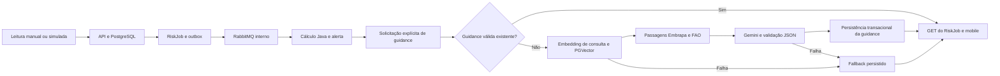

# Arquitetura da IA — AgroConecta

Disciplina: Disruptive Architectures: IoT, IoB & Generative IA — Global Solution 2026/2.

Revisão documental: 16/11/2026. Este documento descreve a implementação consultada, sem alteração de código ou nova execução de testes. O fluxo oficial consumido pelo aplicativo é **RiskJob + guidance**. O fluxo histórico `agronomic_analyses` permanece no backend por compatibilidade e não é a base desta funcionalidade mobile.

Este documento pertence ao **GS-FINAL**, repositório principal da entrega e fonte de referência da arquitetura de IA. O aplicativo `citizentech-mobile` é uma interface complementar; seus caminhos de código são identificados explicitamente abaixo. Os requisitos do enunciado e as rubricas estão em [Evidências de avaliação](EVIDENCIAS_AVALIACAO.md#requisitos-do-enunciado-oficial).

## Objetivo e fronteira da IA

O AgroConecta apoia pequenos produtores na interpretação de condições hídricas do cultivo. A responsabilidade pelo cálculo pertence ao Java; a responsabilidade da IA é transformar o resultado e as evidências recuperadas em uma explicação acessível, com limitações e referências.

| Camada | Responsabilidade | Limite |
| --- | --- | --- |
| Cálculo determinístico | Disponibilidade hídrica, VPD, tendência, regras acionadas e classificação oficial | Depende da qualidade das leituras e dos parâmetros demonstrativos adotados. |
| Orientação generativa | Resumo, sinais, recomendação, ações sugeridas e avisos em português | Não redefine o risco, não comprova diagnóstico e não executa manejo. |
| Aplicativo | Solicitar análise/orientação, consultar estado e apresentar dados e fontes | Não calcula outro `riskLevel` nem se conecta diretamente ao Gemini. |

Os sensores da demonstração são representados por registros da aplicação. As leituras são manuais ou simuladas; não há conexão com ESP32 físico, MQTT ou satélite. A API está preparada para receber leituras externas futuramente por seus contratos de ingestão de dispositivo; isso não comprova hardware integrado. ESP32, MQTT e hardware físico não são exigências do enunciado desta disciplina. RabbitMQ transporta eventos internos da aplicação, sem exercer o papel de broker MQTT.

## Componentes e responsabilidades

Os caminhos Java abaixo pertencem ao repositório backend `GS-FINAL`, sob `src/main/java/br/com/fiap/citizentech/`. Os caminhos TypeScript pertencem ao mobile.

| Componente | Responsabilidade no fluxo |
| --- | --- |
| `sensorreading/service/SensorReadingService` e controladores de simulação | Validar, vincular ao produtor e persistir leituras. A simulação exige habilitação explícita de demonstração. |
| `water/RiskJobController` e `water/RiskJobService` | Receber a solicitação de análise, validar propriedade, capturar snapshots e registrar o evento na outbox. |
| `shared/outbox/OutboxPublisher` e `shared/messaging/RabbitOutboxEventSender` | Publicar eventos internos com controle de confirmação e estado da publicação. |
| `water/RiskJobConsumer` | Consumir o pedido, bloquear o job e executar o cálculo determinístico. |
| `water/WaterIndicators` e `water/WaterRiskCalculator` | Calcular indicadores e aplicar as regras de classificação, sem consultar o Gemini. |
| `water/JobGuidanceController` | Reutilizar guidance válida ou coordenar contexto, recuperação, geração, validação e fallback. |
| `analysis/rag/AgronomyRagLoader` | Carregar o corpus local com metadados, fragmentos, IDs determinísticos e checksums. |
| `analysis/rag/PgVectorAgronomyKnowledge` | Buscar passagens semelhantes e aceitar apenas conteúdo com atribuição e URL válida. |
| `analysis/ai/GeminiAgronomicAiClient` | Enviar instruções e dados separados ao modelo e converter sua resposta estruturada. |
| `analysis/config/AiProperties` e `analysis/config/GeminiConfig` | Validar configuração e disponibilizar clientes reais somente quando habilitados. |
| `water/RiskJobService`, `water/RiskJobRepository` e `water/RiskJob` | Persistir guidance e fallback sob transação e lock por proprietário, preservando o risco. |
| `src/services/guidanceService.ts` e `src/hooks/riskJobs/useGuidance.ts` | Fazer o POST explícito, consultar o mesmo job e tratar sucesso, contingência e incerteza de rede. |
| `src/components/guidance/` | Apresentar orientação e fontes como texto, com abertura de links validada. |

## Fluxo de dados

1. Uma leitura manual é enviada pelo aplicativo ou uma leitura simulada é produzida pelas rotas de demonstração do backend. A API valida dados, vínculo do sensor e permissão do produtor antes de persistir.
2. A solicitação `POST /api/crop-areas/{id}/risk-jobs`, sem body, cria um job com snapshots de medições, parâmetros do perfil, regras e informações de chuva. O evento de processamento é registrado pela outbox na mesma transação.
3. A mensageria interna encaminha o pedido ao consumidor. O Java calcula o resultado e persiste o estado do job; um alerta é criado quando aplicável às regras existentes. O resultado fica disponível sem depender da IA.
4. O usuário solicita `POST /api/risk-jobs/{id}/guidance`, sem body. A API identifica o produtor pelo principal autenticado e busca somente seu job.
5. Se já existe `guidance.fallback=false`, o conteúdo persistido é devolvido imediatamente. Não ocorre nova busca RAG nem geração nesse caminho.
6. Se o cálculo ainda não terminou, a solicitação retorna 409. Um resultado `INSUFFICIENT_DATA` produz fallback `INSUFFICIENT_CONTEXT`, sem consulta vetorial ou chamada de geração. Com IA desabilitada ou cliente indisponível, há contingência identificada.
7. Para uma nova geração elegível, a aplicação monta contexto com o resultado fixo, medições do snapshot, cultura, parâmetros do perfil e tipos/datas de atividades do próprio talhão. A origem manual é confirmada por consulta restrita ao proprietário; não é inferida apenas de `simulated=false`.
8. A consulta RAG é transformada em embedding e comparada com os vetores armazenados no PostgreSQL. Passagens elegíveis e suas referências compõem as evidências enviadas ao Gemini.
9. O modelo gera JSON. Após conversão e validação, a aplicação monta a guidance pública, usa as fontes recuperadas e fixa seu `riskLevel` pelo resultado Java.
10. O serviço persiste o JSON sob lock. O GET do mesmo RiskJob devolve a orientação armazenada, e o aplicativo a apresenta junto ao resultado determinístico. Falhas seguem o caminho de fallback, mantendo os dados do cálculo.

## Banco de dados e PGVector

PostgreSQL armazena o domínio agrícola, leituras, perfis, jobs, alertas e eventos de outbox. Na funcionalidade de IA, três estruturas são centrais:

| Estrutura | Uso |
| --- | --- |
| `risk_jobs` | Resultado determinístico, snapshots e JSONB `guidance` da orientação válida ou do fallback. |
| `agronomy_vector_store` | ID UUID, conteúdo, metadados e coluna `embedding vector(768)` do corpus agronômico. |
| `rag_ingestion` | Chave do documento, checksum e data de atualização para controlar reingestão. |

A migration existente `V6__agronomic_analysis_and_rag.sql` define o armazenamento vetorial com índice HNSW e operadores de distância por cosseno. A coluna de guidance pertence à estrutura já existente, sem necessidade de nova migration nesta documentação.

O carregador divide o conteúdo em fragmentos de até 1.000 caracteres, respeitando pares UTF-16. O ID deriva da fonte, versão e posição do fragmento. O checksum incorpora o texto normalizado, modelo de embedding e dimensão. Se permanecer igual, o documento é ignorado na carga; quando muda, o carregador atualiza os fragmentos daquela fonte. Por isso, não se deve trocar modelo ou dimensão indiscriminadamente no ambiente já validado. Uma instalação vazia exige ingestão e pode consumir chamadas de embedding; isso não ocorreu nesta etapa documental.

PGVector foi escolhido por aproveitar o PostgreSQL já utilizado pelo projeto e permitir busca semântica próxima aos dados relacionais, sem acrescentar outro serviço de banco. Não há comparação experimental com outros bancos vetoriais que sustente uma alegação de superioridade.

## Corpus, fontes e embeddings

O corpus é um conjunto local e curado de **quatro textos curtos de síntese**, com referências institucionais, não uma cópia integral dos sites nem um mecanismo de pesquisa online. Os arquivos ficam em `src/main/resources/rag/agronomy/` no backend.

| Arquivo | Título registrado | Instituição e referência |
| --- | --- | --- |
| `01-irrigacao-milho-v1.md` | Manejo de irrigação do milho | [Embrapa — manejo](https://www.embrapa.br/en/web/agencia-de-informacao-tecnologica/cultivos/milho/producao/irrigacao/manejo) |
| `02-umidade-agricultura-familiar-v1.md` | Umidade do solo na agricultura familiar | [Embrapa — Infoteca](https://www.infoteca.cnptia.embrapa.br/handle/doc/974063) |
| `03-milho-estresse-v1.md` | Desenvolvimento do milho e disponibilidade de água | [Embrapa — características da planta](https://www.embrapa.br/web/agencia-de-informacao-tecnologica/cultivos/milho/pre-producao/caracteristicas-da-especie-e-relacoes-com-o-ambiente/caracteristicas-da-planta) |
| `04-fao-agua-v1.md` | Gestão de água e irrigação | [FAO — irrigation](https://www.fao.org/land-water/water/agricultural-water-management/irrigation/en) |

Esses são os títulos e endereços dos metadados existentes. As fontes foram selecionadas para apoiar a discussão de manejo de água, calibração, desenvolvimento da cultura e limites de interpretação. Sua inclusão não significa validação ou endosso do AgroConecta pelas instituições.

O modelo **`gemini-embedding-001`** produz os vetores configurados com **768 dimensões**. A consulta usa a mesma representação dimensional do índice. O modelo de geração, **`gemini-3.5-flash-lite`**, é distinto do modelo de embedding; trocar o primeiro não exige, por si só, recalcular os vetores existentes.

Os valores padrão de recuperação são `top-k=4` e `similarity-threshold=0.3`, com filtro `corpus == 'agronomy'`. A consulta semântica usa cultura, medição recebida e limitações, sem usar a descrição livre como instrução de busca. Cada passagem recuperada é limitada a 1.600 caracteres. São exigidos metadados não vazios de identificação, título, instituição, URL e versão, além de conteúdo não vazio. As URLs aceitas são HTTP(S), com host e sem credenciais embutidas.

O código considera o contexto suficiente quando há pelo menos **três passagens elegíveis**. Esse critério não equivale a provar três instituições distintas ou correção agronômica. O resultado real registrado recuperou as quatro referências do corpus; a busca não garante quatro retornos em toda solicitação.

## Prompt e contexto

O prompt de sistema está em `src/main/resources/prompts/agronomic-analysis-v1.txt`; a versão registrada pelo cliente é `agronomic-v1`. Ele orienta resposta em português, uso exclusivo das medições e passagens fornecidas, indicação de dados ausentes e respeito ao resultado fixo. Proíbe inventar clima, chuva, características do solo e fontes, recomendar dosagens/agrotóxicos ou acionar irrigação.

O cliente envia separadamente a mensagem de sistema e um JSON de dados com `untrustedFieldData` e `institutionalEvidence`. No fluxo de guidance, esse contexto inclui `fixedResult`, indicação de dados simulados, proveniência manual quando confirmada, tipos e datas de atividades recentes e valores do perfil usados no snapshot. Não são enviados nome do produtor, credenciais, código do dispositivo ou descrições livres do diário nesse contexto. O limite configurado é de 16.000 caracteres para o JSON montado pelo cliente.

Essa estrutura mantém as evidências recuperadas identificadas como dados não confiáveis. Conteúdo de cultura, atividade ou documento não ganha autoridade para mudar o papel do modelo, o formato de saída ou o resultado Java. A defesa de prompt reduz o risco, mas não garante que todo texto gerado seja correto; a proteção do campo de risco também existe no serviço, independentemente da obediência textual do modelo.

## Saída estruturada e proteção do `riskLevel`

O `BeanOutputConverter<AgronomicAdvice>` fornece o esquema JSON ao cliente. A resposta é solicitada com `responseMimeType=application/json`, temperatura padrão 0,2 e Google Search desativado. A conversão ocorre separadamente da chamada de transporte, permitindo classificar uma resposta ilegível como saída estruturada inválida.

`AgronomicAdvice` exige enums e campos obrigatórios, limita resumo a 2.000 caracteres, recomendação a 4.000 e cada lista do modelo a até dez textos de até 500 caracteres. O controller aplica Jakarta Validation e rejeita resposta nula ou inválida. Os limites das listas dizem respeito à saída do modelo: o backend pode acrescentar avisos determinísticos ao construir a guidance final.

O DTO do modelo contém um campo de risco, mas **esse campo não é usado para definir a classificação pública da guidance**. O controller copia `job.result.riskLevel`; `RiskJobService.authoritativeGuidance` repete essa atribuição com a entidade bloqueada. Um modelo que retorne `LOW` para um job `CRITICAL` não altera o resultado oficial. As fontes públicas também são as do RAG recuperado, sem aceitar referências inventadas na prosa.

Os avisos acrescentados pela aplicação preservam parâmetros demonstrativos e leituras simuladas como conceitos diferentes. A formulação de leitura manual demonstrativa só é usada quando todos os IDs do snapshot têm origem manual confirmada no escopo do proprietário. `simulated=false` isoladamente não comprova medição física nem distingue MANUAL de DEVICE.

## Persistência, concorrência e reutilização

`saveGuidance` e `saveFallbackGuidance` são operações transacionais do serviço. Ambas obtêm o job por `lockOwned(id, ownerId)`, com `PESSIMISTIC_WRITE`, exigem resultado existente e gravam na coluna `guidance` já disponível. Não dependem de uma alteração em entidade destacada no controller.

| Resultado | Campos e estado relevantes |
| --- | --- |
| Guidance válida | `fallback=false`, `summary`, `recommendation`, `recommendedActions`, `signals`, `warnings`, `sources`, `model`, `promptVersion`, `generatedAt` e risco copiado do cálculo. Estado `COMPLETED`. |
| Fallback | `fallback=true`, `reason`, resumo/recomendação de contingência, ações, sinais, avisos, `sources=[]`, data e risco do cálculo. Não é apresentado como geração válida; no fluxo concluído sem IA, conserva `COMPLETED_WITHOUT_AI`. |

O GET posterior devolve o JSON persistido. Uma guidance válida existente tem prioridade; um fallback tardio não a sobrescreve. Fallback pode ser substituído por orientação válida em uma tentativa manual posterior. Snapshots, indicadores, resultado e estado administrativo do alerta não são recalculados pela gravação de guidance.

O lock protege a persistência concorrente e a prioridade do sucesso. Ele não demonstra deduplicação de toda chamada externa que possa ser iniciada simultaneamente antes da primeira gravação. A evidência disponível cobre a integridade do job, não uma garantia global de chamada única sob qualquer concorrência.

## Fallback e classificação de falhas

| Motivo | Condição tratada |
| --- | --- |
| `PROVIDER_UNAVAILABLE` | IA desligada, cliente ausente ou falha que impeça a obtenção de orientação e não pertença às categorias específicas abaixo. |
| `CALL_TIMEOUT` | Prazo da tarefa excedido ou timeout de transporte reconhecido. |
| `NO_RELEVANT_SOURCES` | Recuperação sem o mínimo de passagens elegíveis. A geração não é chamada nesse caso. |
| `INVALID_STRUCTURED_OUTPUT` | Resposta nula, JSON não convertível ou violações das restrições do DTO. |
| `INSUFFICIENT_CONTEXT` | Resultado determinístico `INSUFFICIENT_DATA`; não há chamada ao RAG ou ao modelo. |

O fallback é uma orientação de contingência explícita, não uma resposta generativa bem-sucedida. Ele permite consultar o risco calculado mesmo sem Gemini ou PGVector disponíveis. Mensagens brutas do provedor, prompts e stack traces não são usados como conteúdo destinado ao usuário. Erros de autenticação, autorização e job ainda não concluído conservam seus contratos HTTP; não são convertidos artificialmente em sucesso da IA.

## Timeouts e ausência de retries automáticos de guidance

| Configuração ou camada | Comportamento confirmado |
| --- | --- |
| `AI_CALL_TIMEOUT` | Padrão `PT90S`; limita a espera pela tarefa que inclui recuperação RAG e geração. Não são dois orçamentos consecutivos de 90 segundos. |
| Transporte Google | Cliente recebe timeout da chamada e `HttpRetryOptions.attempts=1`, compartilhado por chat e embedding. |
| Spring AI | `spring.ai.retry.max-attempts=0`; a composição instalada e seu teste verificam uma execução, sem retry. |
| `AI_PROCESSING_TIMEOUT` | Padrão `PT5M`, maior que o timeout de chamada; usado na reserva/recuperação do fluxo legado de análises, sem ampliar a espera de guidance. |
| Mobile | POST de guidance com timeout exclusivo de 180 segundos e mutation com `retry=false`. |

O prazo da tarefa dispara cancelamento por interrupção; uma chamada já recebida pelo provedor pode continuar sendo processada fora da aplicação. Falha de rede no mobile não comprova ausência de gravação: a interface orienta consultar o mesmo job antes de outra geração explícita. A consulta GET não gera orientação.

A ausência de retries automáticos descrita aqui se refere à **guidance**. Outbox, entrega de mensagens e fluxo legado possuem mecanismos próprios de repetição e recuperação, que não devem ser apresentados como inexistentes em toda a solução.

## Isolamento e operação segura

O proprietário é obtido do principal autenticado e validado como produtor ativo no banco. Os endpoints não aceitam `ownerId` do cliente para selecionar o dono da orientação. As consultas de job e os locks restringem o produtor; atividades e confirmação de origem manual também respeitam esse escopo. Os testes verificam negação de acesso de outro produtor, ausência de dados alheios no contexto e preservação do snapshot.

A chave Google pertence apenas ao ambiente do backend. `APP_AI_ENABLED=false` permite iniciar sem chave e sem resolver os clientes externos. Quando o provedor Gemini está habilitado, a chave é exigida. O aplicativo usa sua sessão autenticada para falar com a API e não recebe a chave do provedor. Instruções de entrada oculta e execução estão na [seção de entrega do README](../../README.md#configuração-segura-e-execução), sem valores de credenciais.

## Limitações conhecidas e avaliação

- Não há aquisição por hardware físico, MQTT, satélite ou acionamento de irrigação. A saúde do sensor é calculada por heurísticas demonstrativas, sem diagnóstico de equipamento em campo.
- O corpus tem quatro sínteses e foco limitado; não cobre toda cultura, região, estágio fenológico ou condição de solo. A recuperação não atualiza as fontes online.
- Parâmetros demonstrativos, falta de calibração e dados incompletos restringem o significado dos indicadores, mesmo quando calculados corretamente pelo Java.
- Estrutura JSON válida não garante adequação de cada afirmação. O uso continua sendo apoio à decisão com avaliação agronômica humana.
- Rede, disponibilidade e cotas do provedor afetam a geração; não foram demonstradas garantias de disponibilidade, custo, latência ou escala de produção.
- Proteções de prompt e isolamento têm evidência automatizada local; não equivalem a garantia absoluta contra qualquer entrada adversarial.
- A validação HTTP real não substitui ensaio de campo, avaliação agronômica independente ou validação de interação/acessibilidade em Android e iOS.

A evidência real existente registrou quatro fontes, guidance válida persistida e risco preservado. Reutilização, persistência de fallback e cenários de erro também possuem testes locais. A matriz distingue esses níveis de evidência em [EVIDENCIAS_AVALIACAO.md](EVIDENCIAS_AVALIACAO.md). Não se atribui ao projeto uma melhoria produtiva ou economia de água que não tenha sido medida.
